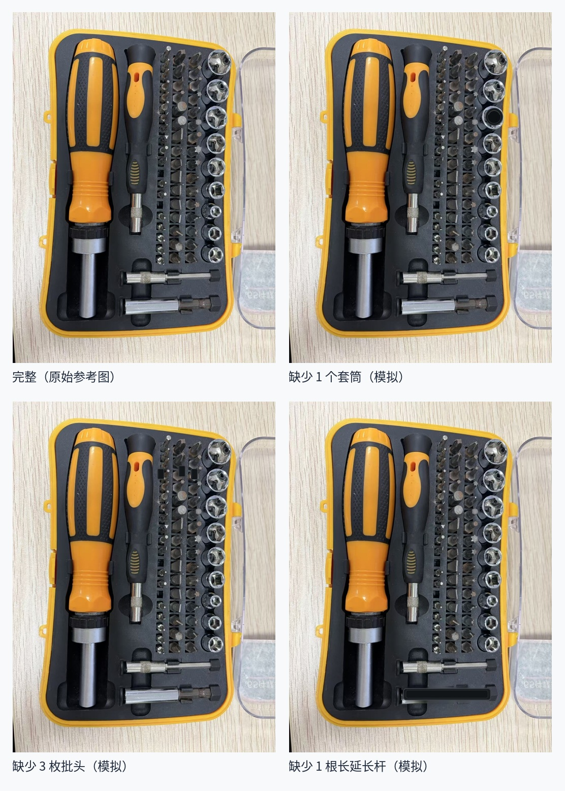

# 机务小工具识别与缺失检测 Demo

## 完整项目实施说明书（Codex 开发版 v0.3）

-   项目类型：本地可运行的视觉识别 Web Demo
-   目标：上传工具盒照片，调用 Qwen-VL
    视觉模型识别工具、输出边界框、统计数量，并与标准清单比较，提示缺失项
-   开发入口：Codex
-   辅助工具链：Pi + Magpie + Herdr
-   运行方式：Docker Compose 一键启动
-   当前阶段：演示型 MVP，不做模型训练，不承诺生产级识别精度

------------------------------------------------------------------------

## 0. 给 Codex 的最高优先级说明

请将本文件视为当前版本的需求基线。先做出能运行、能演示的完整闭环，再接入真实
Qwen API。

**必须先完成：**

1.  项目能通过 Docker Compose 启动。
2.  浏览器可以打开上传页面。
3.  可以选择本项目提供的四张样例图片。
4.  Mock 模式能稳定展示识别框、工具清单、数量统计、缺失提示。
5.  没有 API Key 时不影响上述功能。
6.  Qwen API 配置完成后，可切换为真实识别模式。

**不要做：**

-   不要训练 YOLO 或其他检测模型。
-   不要引入数据库、登录、复杂权限、微服务或云部署，除非后续明确提出。
-   不要把 Qwen 生成的猜测当作确定事实。
-   不要把合成缺失图当作真实采集数据或准确率测试数据。
-   不要把 API Key 放在前端。

## 1. 项目背景与目标

当前有一套黄色外壳、黑色内托的螺丝刀/批头工具盒。用户拍摄工具盒照片后，希望网页自动识别盒内工具，显示目标框和标签，统计各类工具数量，并与预设标准清单比较，给出"完整
/ 缺失 / 需人工复核"的结果。

### 1.1 Demo 目标

-   一张图片完成一次识别。
-   展示原始照片及检测框叠加效果。
-   展示识别到的工具类别、数量和置信度。
-   展示标准数量、实际数量、缺失数量。
-   对缺失项给出醒目提示。
-   提供完整与缺失的演示样例。
-   同一套前端支持 Mock 模式和 Qwen 真实 API 模式。
-   使用 Docker Compose 一条命令启动。

### 1.2 本期非目标

-   不训练或微调视觉模型。
-   不做视频流、实时摄像头或移动端 App。
-   不做多工具盒型号管理（数据结构预留即可）。
-   不做用户登录、角色权限、云端数据库、历史记录和报表导出。
-   不以当前样例图片证明模型的实际准确率。

## 2. 工具链：Pi + Magpie + Herdr TUI + Codex

这四者承担不同职责，不能混为一个运行系统。

  工具          本项目职责                                        是否属于网页运行依赖
  ------------- ------------------------------------------------- ----------------------
  Codex         主开发 Agent，按本文档编写项目、测试、修复问题    否
  Pi            辅助 Agent，用于代码审查、Prompt 优化、测试设计   否
  Magpie        管理 Codex / Pi 使用的模型供应商与模型切换        否
  Herdr         管理多个终端 Pane、Agent 会话和日志窗口           否
  Qwen-VL API   网页后端实际调用的视觉模型                        是（Qwen 模式）

**重要区别：** Magpie 的本地 Gateway 是给开发工具（Codex / Pi
等）使用的模型路由层；网页后端调用 Qwen 视觉 API
时，默认直接使用用户提供的 Qwen API 配置。不要默认让 Docker
容器依赖宿主机上的 Magpie Gateway。

### 2.1 从只有 Codex 开始的完整安装流程

本项目不假设用户已经安装 Pi、Magpie、Herdr 或
Docker。当前默认起点是"用户只有 Codex"。

**必须先阅读项目根目录的
`BOOTSTRAP_FROM_CODEX_ONLY_CN.md`，按其中的阶段顺序完成环境初始化。**
该文件提供 Windows PowerShell、macOS / Linux 命令、Codex CLI 检查、Pi
安装、Magpie Provider 配置、Herdr TUI 集成、Docker
安装、配置备份和验收清单。

严格执行顺序：

1.  检查现有 Codex 是桌面 App、CLI，还是两者都有；Herdr Pane 需要终端
    `codex` CLI。
2.  如果 `codex` CLI 不存在，保留桌面 App，按指南安装 Codex CLI
    并完成登录。
3.  安装 Pi，并确认 `pi --version`。
4.  安装 Magpie；通过 Magpie Providers 添加用户有权使用的模型来源，再在
    Agents 中分别为 Codex / Pi 选择模型。
5.  安装 **Herdr TUI**（不是独立的 Herdr 桌面 App），执行
    `herdr integration install codex`、`herdr integration install pi` 和
    `herdr integration status`。
6.  检查 Docker / Docker Compose。
7.  在 Herdr 工作区启动 Codex、Pi 和 Docker 日志 Pane。

### 2.2 安装和配置中的重要边界

-   安装前检查并备份 Codex 配置；Magpie 可能更新 Codex 模型 Provider
    配置，Herdr Codex 集成会更新 Hooks 配置。
-   Pi 的 Herdr 集成要求 Pi Agent 配置目录已经存在；先启动 Pi
    一次再安装集成。
-   Herdr 的 Codex 集成要求 Codex 配置目录已经存在；先启动 Codex CLI
    一次再安装集成。
-   Magpie 的本地 Gateway 默认位于 `127.0.0.1:3425`，服务于开发
    Agent，不是本项目 Docker 后端默认调用的 Qwen 地址。
-   当前没有 Qwen API Key 不影响 Mock Demo。Qwen-VL API
    配置由用户后续提供。
-   所有账号登录、授权、密码和 API Key
    输入由用户本人完成；不得将密钥发给 Codex 对话或写进源码。
-   Herdr TUI 与独立 Herdr 桌面 App 是不同入口；本项目需要支持
    `herdr integration` 命令的 TUI 版本。

官方文档：

-   Pi：<https://docs.pi.dev/latest/quickstart>
-   Magpie：<https://usemagpie.ai/docs/start>
-   Herdr TUI 安装：<https://herdr.dev/tui/docs/install/>
-   Herdr TUI 集成：<https://herdr.dev/tui/docs/integrations/>
-   Docker：<https://docs.docker.com/get-started/get-docker/>

### 2.3 推荐 Herdr 工作区布局

在同一个项目 Workspace 中开 3 个 Pane：

-   Pane A：`codex` ------ 主开发与执行任务。
-   Pane B：`pi` ------ 代码审查、Prompt
    审查、测试遗漏检查；默认只读审查，不和 Codex 同时改同一文件。
-   Pane C：`docker compose logs -f web` ------ 观察应用日志。

需要运行测试时可临时开 Pane D：`npm test` 或 `npm run lint`。

**并行协作规则：** Codex 是唯一主写入者。Pi 先给审查意见，Codex
决定是否采纳。若确实需要 Pi 修改代码，必须使用独立 Git 分支或
Worktree，避免两个 Agent 同时覆盖文件。

## 3. 基于原始照片的初始工具标准清单

文件：`config/tool_inventory.json`

下表是根据用户提供的单张照片建立的**Demo 暂定基线**，不是厂商
BOM，也不是经人工逐件核验的最终标准。

  --------------------------------------------------------------------------------------------------------------------------
  class_id                    中文名称              暂定标准数量  计数方式     可信程度   备注
  --------------------------- -------------------- -------------- ------------ ---------- ----------------------------------
  `large_driver_handle`       大号螺丝刀手柄组件         1        整体组件     高         手柄及其下方连接杆按一件组件计数

  `small_driver_handle`       小号螺丝刀手柄组件         1        整体组件     高         手柄及前端连接结构按一件组件计数

  `socket`                    套筒                       8        单个计数     中         按照片右侧竖向排列的可见套筒估算

  `bit_head`                  批头                       40       数量统计 +   低         约数，仅用于
                                                                  分组框                  Demo；必须允许后续调整

  `short_extension_adapter`   短延长杆 / 转接杆          1        单个计数     中         照片下部横向上方的短件

  `long_extension_bar`        长延长杆                   1        单个计数     中         照片下部横向下方的长银色件
  --------------------------------------------------------------------------------------------------------------------------

暂定总数：52 件（其中批头约 40
件）。**总数仅是演示用估算，不得作为正式盘点标准。**

### 3.1 识别粒度

-   大号手柄、小号手柄：每件一个框。
-   套筒：尽量逐个框选，每个套筒一个实例。
-   批头：本期优先按三列/区域分组框选，并输出估算数量；不要强制要求模型对每一枚极小批头都给出高精度独立框。
-   短延长杆、长延长杆：各自一个框。

### 3.2 清单可配置要求

-   标准数量不得硬编码在页面组件中。
-   页面或配置文件可以调整 `expectedCount`。
-   对 `confidence: low` 的批头数量，在页面显示"暂定标准"。
-   对用户尚未确认的标准数量，不能直接判定正式"盘点合格"。

## 4. 演示图片与样例场景

文件位于 `samples/`：

  ------------------------------------------------------------------------
  文件                           场景                 Mock 预期结果
  ------------------------------ -------------------- --------------------
  `complete_reference.jpg`       原始完整参考照片     完整（按暂定标准）

  `missing_one_socket.jpg`       合成：移除 1 个套筒  套筒缺少 1 个

  `missing_three_bits.jpg`       合成：移除 3 枚批头  批头缺少 3 枚

  `missing_long_extension.jpg`   合成：移除 1         长延长杆缺少 1 根
                                 根长延长杆           

  `samples_preview.jpg`          四张样例的 2×2       仅供快速查看
                                 预览图               
  ------------------------------------------------------------------------



### 4.1 合成图片使用说明

缺失图片是基于原始照片进行局部图像修补得到的**合成演示素材**。局部纹理可能不自然，图片不代表真实拍摄现场，也不是经过标注的训练数据。

-   可用于网页上传流程、Mock 结果展示、UI 演示。
-   不可用于计算 Qwen 真实准确率、召回率或误检率。
-   不可作为模型训练集或正式验收数据。
-   后续应使用真实拍摄的完整/缺失图片替换或补充。

### 4.2 Mock 场景的确定性

Mock 模式不要真的调用模型。用户点击某张样例卡片时，前端把 `sampleId`
一并提交到后端；后端按 `config/mock_scenarios.json`
返回固定结果。这样演示结果可重复，不会因为模型输出波动而改变。

若用户上传自定义图片但没有对应 `sampleId`，Mock
模式必须显示"模拟结果"，可返回通用示例框或要求选择样例；不能声称它完成了真实识别。

## 5. 技术方案

### 5.1 推荐技术栈

  ----------------------------------------------------------------------
  层                     技术                   说明
  ---------------------- ---------------------- ------------------------
  前端                   Next.js App Router +   页面和 API
                         React + TypeScript     同仓库，降低部署复杂度

  UI                     Tailwind CSS           快速完成响应式界面

  校验                   Zod                    校验 API 输入和模型 JSON
                                                输出

  图片展示               原生 `` / Next    画框和标签
                         Image + SVG Overlay    

  模型接口               OpenAI-compatible Chat 具体协议按用户提供的 API
                         Completions 或         配置
                         DashScope API          

  部署                   Docker + Docker        一条命令启动
                         Compose                

  数据库                 本期不需要             标准清单和 Mock 结果放
                                                JSON 文件
  ----------------------------------------------------------------------

建议把前后端放在同一个 Next.js 服务中，暂不拆成多个容器。这样 Demo
更容易启动、调试和交付。

### 5.2 系统结构

``` text
Browser
  |
  | upload image / choose sample
  v
Next.js Web UI
  |
  | POST /api/analyze
  v
Next.js Server API
  |
  +--> MockVisionProvider --------> mock_scenarios.json
  |
  +--> QwenVisionProvider --------> Qwen-VL API
  |
  v
Normalize + Validate Result (Zod)
  |
  +--> Compare observed counts with tool_inventory.json
  |
  v
Return normalized JSON
  |
  v
Browser draws SVG boxes + inventory table + status summary
```

### 5.3 运行模式

-   `mock`：默认模式，不需要 API Key，供前期开发和演示使用。
-   `qwen`：真实模式，服务端调用 Qwen API。

模式通过环境变量 `ANALYSIS_MODE` 控制，也可以在 UI
中展示当前模式。为避免用户误解，真实模式和 Mock
模式必须有清楚的文字标识。

## 6. 页面与交互需求

页面标题：**机务小工具识别与缺失检测 Demo**

### 6.1 页面布局

1.  顶部 Header：项目名称、当前模式（Mock / Qwen）、API 配置状态。
2.  左侧或顶部上传区：拖拽上传、点击选择文件、文件名、文件大小、图片尺寸。
3.  样例区：四张样例卡片，点击后加载样例图并触发对应 Mock 场景。
4.  图片检测区：显示原图；支持适配容器、缩放（可选）、显示/隐藏检测框。
5.  结果摘要区：整体状态、标准总数、识别总数、缺失种类数。
6.  工具清单表：工具名称、标准数量、识别数量、缺失数量、置信度、状态。
7.  缺失提示区：以红色/橙色显示缺失项；不确定项显示"需人工复核"。
8.  底部说明：Mock 数据仅用于演示；批头标准数量暂定。

### 6.2 主要交互

-   上传图片：支持 JPG / JPEG / PNG / WEBP。
-   限制文件大小：默认 7 MB，可通过 `MAX_UPLOAD_MB` 修改。
-   点击"开始识别"：调用 `/api/analyze`。
-   点击样例图：加载对应图片和确定性 Mock 结果。
-   点击"重新识别"：按当前模式再次执行。
-   点击"重置"：清空当前图片和结果。
-   显示/隐藏框：切换 SVG Overlay。
-   识别中：按钮 loading，展示进度或"正在分析图片"。
-   出错：显示明确错误原因和重试入口。

### 6.3 检测框视觉规范

-   正常识别项：绿色框。
-   缺失项的预期空槽位置：红色或橙色虚线框，并标记"缺失"。
-   低置信度/需要人工确认：黄色框。
-   标签显示：名称 + 数量 + 置信度（例如"套筒 × 7 · 0.91"）。
-   框和原图必须同步缩放，不能因 `object-fit: contain` 导致坐标偏移。

**坐标绘制要求：** 统一将后端结果归一化到 `[0,1000]`。前端 SVG
使用与图片显示区域一致的
viewBox，保证图片缩放、容器宽度变化时框仍然准确。缺失项没有实际物体框时，只有模型/Mock
能提供可靠空槽坐标才绘制"预期位置框"；不能随意画在图片上。

## 7. API 设计

### 7.1 `GET /api/health`

返回服务健康状态，不泄露密钥：

``` json
{
  "ok": true,
  "mode": "mock",
  "qwenConfigured": false
}
```

### 7.2 `GET /api/samples`

返回可用样例列表：

``` json
{
  "samples": [
    { "id": "complete", "name": "完整工具盒", "image": "/samples/complete_reference.jpg" },
    { "id": "missing_socket", "name": "缺少 1 个套筒", "image": "/samples/missing_one_socket.jpg" },
    { "id": "missing_bits", "name": "缺少 3 枚批头", "image": "/samples/missing_three_bits.jpg" },
    { "id": "missing_extension", "name": "缺少 1 根长延长杆", "image": "/samples/missing_long_extension.jpg" }
  ]
}
```

### 7.3 `GET /api/inventory`

返回 `config/tool_inventory.json` 的当前内容。

### 7.4 `POST /api/analyze`

Content-Type：`multipart/form-data`

字段：

-   `image`：图片文件，必填。
-   `mode`：`mock` 或 `qwen`；未传时使用 `ANALYSIS_MODE`。
-   `sampleId`：可选；选择样例图时传入，Mock 模式据此返回固定结果。
-   `inventoryId`：可选；默认使用当前工具盒标准清单。

成功响应统一为：

``` json
{
  "requestId": "demo-request-id",
  "mode": "mock",
  "status": "missing",
  "image": { "width": 1279, "height": 1706 },
  "summary": {
    "expectedTotal": 52,
    "observedTotal": 51,
    "missingKinds": 1,
    "needsReviewKinds": 0
  },
  "detections": [
    {
      "id": "socket-group-1",
      "classId": "socket",
      "label": "套筒",
      "count": 7,
      "bbox": { "x1": 745, "y1": 80, "x2": 860, "y2": 610 },
      "confidence": 0.9,
      "reviewRequired": false,
      "displayMode": "instances_or_group"
    }
  ],
  "inventory": [
    {
      "classId": "socket",
      "label": "套筒",
      "expectedCount": 8,
      "observedCount": 7,
      "missingCount": 1,
      "status": "missing",
      "confidence": 0.9,
      "provisionalStandard": false
    }
  ],
  "missingSlots": [
    {
      "classId": "socket",
      "label": "套筒缺失位置",
      "bbox": { "x1": 745, "y1": 270, "x2": 815, "y2": 325 },
      "confidence": 0.8
    }
  ],
  "warnings": ["当前为 Mock 演示结果，不代表真实模型识别。"],
  "generatedAt": "2026-11-20T00:00:00.000Z"
}
```

`status` 枚举：`complete` / `missing` / `needs_review`。

`inventory[].status` 枚举：`normal` / `missing` / `uncertain`。

### 7.5 错误响应

统一格式：

``` json
{
  "error": {
    "code": "QWEN_API_ERROR",
    "message": "视觉模型调用失败，请检查 API 配置后重试。"
  }
}
```

不得把完整 API Key、Authorization Header 或供应商内部堆栈返回给浏览器。

## 8. Qwen 视觉模型接入规范

### 8.1 配置原则

用户后续会提供 API 信息。Codex 现在先完成 Provider 接口和 Mock
模式，不得等待 API 才开始开发。

建议环境变量：

``` dotenv
ANALYSIS_MODE=mock
QWEN_API_KEY=
QWEN_BASE_URL=
QWEN_MODEL=
QWEN_API_PROTOCOL=openai-compatible
QWEN_BBOX_COORD_MODE=normalized_0_999
MAX_UPLOAD_MB=7
QWEN_TIMEOUT_MS=90000
```

-   `QWEN_API_KEY`：服务端密钥。
-   `QWEN_BASE_URL`：用户提供的百炼地域兼容接口地址；不要假设所有账号、地域使用同一
    URL。
-   `QWEN_MODEL`：用户实际可用的 Qwen-VL 模型名称。
-   `QWEN_API_PROTOCOL`：本期优先 `openai-compatible`；若用户给的是
    DashScope 原生接口，再增加对应 Provider。
-   `QWEN_BBOX_COORD_MODE`：指定模型返回坐标的格式。

### 8.2 图片输入

后端接收 multipart 图片后：

1.  校验 MIME 类型、文件扩展名和实际文件签名。
2.  限制文件大小，默认 7 MB。
3.  读取图片宽高。
4.  对小于限制的本地图片编码为 Base64 Data URL。
5.  由服务端向 Qwen API 发送图片和 Prompt。

不要将图片或密钥交给浏览器端第三方脚本。不要把密钥写入 `NEXT_PUBLIC_`
环境变量。

### 8.3 Qwen Prompt 初稿

将以下 Prompt
放在服务端文件中，方便迭代。实际请求时把工具标准清单动态插入 Prompt。

``` text
你是一个工具盒视觉盘点助手。请只分析输入图片中实际可见的工具盒及工具。

任务：
1. 识别工具盒中的大号螺丝刀手柄组件、小号螺丝刀手柄组件、套筒、批头、短延长杆/转接杆、长延长杆。
2. 统计每类可见数量，并与提供的标准清单比较。
3. 尽可能返回物体或物体组的二维边界框。
4. 观察工具盒内托的槽位：如果有明确空槽且可判断对应物品缺失，可以返回缺失位置框。
5. 对过小、遮挡、反光、重叠或无法判断的对象，标记 uncertain，不要猜测成确定数量。
6. 批头非常密集时允许按列或区域分组框选，返回组的 bbox 和估算数量，不要求每一枚都独立框选。
7. 不要推断图片外或被遮挡的物体，不要虚构不存在的工具。

标准清单：
{{INVENTORY_JSON}}

输出要求：
- 只输出符合指定 Schema 的 JSON，不要输出 Markdown 代码围栏或解释段落。
- bbox_2d 格式为 [x1, y1, x2, y2]。
- 坐标按当前配置的坐标规范输出；若不能确定坐标或数量，返回 null 并说明原因。
- 每个识别项必须包含 class_id、label、count、bbox_2d、confidence、review_required。
- 缺失项必须包含 class_id、missing_count、confidence；只有能定位空槽时才返回 slot_bbox_2d。
- overall_status 只能是 complete、missing、needs_review。
- 置信度范围为 0 到 1。
```

### 8.4 建议模型 JSON 输出结构

``` json
{
  "items": [
    {
      "class_id": "socket",
      "label": "套筒",
      "count": 7,
      "bbox_2d": [745, 80, 860, 610],
      "confidence": 0.9,
      "review_required": false,
      "display_mode": "group"
    }
  ],
  "missing_items": [
    {
      "class_id": "socket",
      "missing_count": 1,
      "slot_bbox_2d": [745, 270, 815, 325],
      "confidence": 0.8
    }
  ],
  "uncertain_items": [],
  "overall_status": "missing",
  "notes": []
}
```

这只是模型输出契约，不代表模型一定能稳定按此格式返回。服务端必须用 Zod
校验；校验失败时可进行一次受控 JSON
修复/重试，仍失败则返回可读错误，不得静默伪造结果。

### 8.5 坐标处理（关键）

不同 Qwen-VL 系列的二维定位坐标规范可能不同：部分新系列使用 `[0,999]`
归一化坐标，部分旧系列可能返回缩放后图像的像素坐标。不能只凭 Prompt
猜测。

服务端必须：

1.  由 `QWEN_BBOX_COORD_MODE` 明确选择解析方式。
2.  解析后统一转换为内部 `[0,1000]` 归一化坐标。
3.  保存原图宽高和模型坐标模式，便于调试。
4.  对超出范围、反向、面积为零或明显异常的框进行校验。
5.  UI 仅消费内部归一化坐标，不处理供应商原始坐标。

建议内部转换：

-   `normalized_0_999`：`internal = raw / 999 * 1000`。
-   `normalized_0_1000`：原样使用。
-   `pixel`：`x / modelImageWidth * 1000`，`y / modelImageHeight * 1000`。

如果模型调用时对图片做了缩放，必须使用实际送给模型的图片宽高，不可直接用浏览器原图宽高换算像素坐标。

### 8.6 Qwen 结果可信度策略

-   置信度 `>= 0.80`：可显示为较高可信度，但仍不等于已验证准确。
-   置信度 `0.55 - 0.79`：显示"建议复核"。
-   置信度 `< 0.55` 或数量为 null：显示"无法确定 / 需人工复核"。
-   对批头类默认更谨慎：即使模型给出数量，也在标准数量未核准前显示"暂定标准"。
-   若模型无法识别空槽，不要仅凭数量差异虚构空槽框。

阈值放在配置文件中，不要散落在组件中。

## 9. Mock Provider 规范

Mock Provider 必须与 Qwen Provider 实现同一个接口，返回同一套内部 JSON
Schema。

### 9.1 四个固定场景

  -----------------------------------------------------------------------
  sampleId               预期状态               预期差异
  ---------------------- ---------------------- -------------------------
  `complete`             `complete`             所有项目按暂定标准齐全

  `missing_socket`       `missing`              `socket`：8 → 7，缺少 1

  `missing_bits`         `missing`              `bit_head`：40 → 37，缺少
                                                3

  `missing_extension`    `missing`              `long_extension_bar`：1 →
                                                0，缺少 1
  -----------------------------------------------------------------------

### 9.2 Mock 框坐标

坐标仅用于当前原图尺寸 1279×1706 的演示，统一换算为 0-1000：

  类别           示例 bbox `[x1,y1,x2,y2]`
  -------------- ---------------------------
  大号手柄组件   `[130, 45, 420, 725]`
  小号手柄组件   `[345, 65, 455, 530]`
  批头组区域     `[455, 70, 745, 710]`
  套筒列区域     `[745, 80, 865, 610]`
  短延长杆       `[420, 755, 790, 815]`
  长延长杆       `[420, 815, 790, 875]`

缺失位置框只在对应 Mock 场景中显示：

-   缺套筒：`[745, 270, 815, 325]`（近似空槽位置）。
-   缺批头：`[540, 120, 720, 300]`（批头区域提示框，表示分组缺失，不代表逐枚精确定位）。
-   缺长延长杆：`[420, 815, 790, 875]`。

如果这些框在实际浏览器中和图片对不齐，Codex 应根据原始样例图校准 Mock
坐标；不要为了匹配表格数字而保留明显错位的框。

## 10. 项目目录建议

``` text
toolbox-vision-demo/
├── app/
│   ├── page.tsx
│   ├── layout.tsx
│   └── api/
│       ├── health/route.ts
│       ├── samples/route.ts
│       ├── inventory/route.ts
│       └── analyze/route.ts
├── components/
│   ├── upload-panel.tsx
│   ├── sample-gallery.tsx
│   ├── image-viewer.tsx
│   ├── detection-overlay.tsx
│   ├── result-summary.tsx
│   ├── inventory-table.tsx
│   └── status-badge.tsx
├── lib/
│   ├── providers/vision-provider.ts
│   ├── providers/mock-provider.ts
│   ├── providers/qwen-provider.ts
│   ├── prompts/toolbox-inspection.ts
│   ├── schemas/analysis-result.ts
│   ├── bbox/normalize.ts
│   ├── inventory/compare.ts
│   └── utils/image-validation.ts
├── config/
│   ├── tool_inventory.json
│   └── mock_scenarios.json
├── public/
│   └── samples/
├── tests/
│   ├── inventory.test.ts
│   ├── bbox.test.ts
│   └── mock-provider.test.ts
├── Dockerfile
├── docker-compose.yml
├── .dockerignore
├── .env.example
├── .gitignore
├── next.config.ts
├── package.json
└── README.md
```

目录可以按 Next.js 实际约定调整，但职责必须分层，不能把 Qwen
调用、坐标换算、数量对比全部塞进一个页面组件。

## 11. Docker 一键启动要求

### 11.1 最终用户体验

在项目根目录执行：

``` bash
docker compose up --build -d
```

然后打开：

``` text
http://localhost:3000
```

第一次构建需要联网拉取基础镜像和安装依赖。后续启动可使用：

``` bash
docker compose up -d
```

查看日志：

``` bash
docker compose logs -f web
```

停止：

``` bash
docker compose down
```

### 11.2 Docker Compose 最小参考

Codex 应在项目根目录创建
`docker-compose.yml`，至少满足以下配置。可根据实际 Dockerfile / Next.js
standalone 输出调整：

``` yaml
services:
  web:
    build:
      context: .
      dockerfile: Dockerfile
    container_name: toolbox-vision-demo
    ports:
      - "3000:3000"
    restart: unless-stopped
    environment:
      NODE_ENV: production
      PORT: "3000"
      ANALYSIS_MODE: ${ANALYSIS_MODE:-mock}
      QWEN_API_KEY: ${QWEN_API_KEY:-}
      QWEN_BASE_URL: ${QWEN_BASE_URL:-}
      QWEN_MODEL: ${QWEN_MODEL:-}
      QWEN_API_PROTOCOL: ${QWEN_API_PROTOCOL:-openai-compatible}
      QWEN_BBOX_COORD_MODE: ${QWEN_BBOX_COORD_MODE:-normalized_0_999}
      MAX_UPLOAD_MB: ${MAX_UPLOAD_MB:-7}
      QWEN_TIMEOUT_MS: ${QWEN_TIMEOUT_MS:-90000}
    healthcheck:
      test:
        - CMD
        - node
        - -e
        - "fetch('http://127.0.0.1:3000/api/health').then(r=>process.exit(r.ok?0:1)).catch(()=>process.exit(1))"
      interval: 30s
      timeout: 5s
      retries: 3
      start_period: 20s
```

### 11.3 Dockerfile 要求

-   使用 Node.js 22 LTS 基础镜像。
-   使用多阶段构建，生产镜像只保留运行所需文件。
-   Next.js 可使用 `output: 'standalone'`。
-   容器以非 root 用户运行。
-   对外暴露 3000 端口。
-   启动命令稳定，容器退出时能看到明确日志。
-   样例图片必须打包到 `public/samples/`。

### 11.4 环境变量模板

创建 `.env.example`：

``` dotenv
ANALYSIS_MODE=mock
QWEN_API_KEY=
QWEN_BASE_URL=
QWEN_MODEL=
QWEN_API_PROTOCOL=openai-compatible
QWEN_BBOX_COORD_MODE=normalized_0_999
MAX_UPLOAD_MB=7
QWEN_TIMEOUT_MS=90000
```

Mock 模式无需填写 Qwen 配置即可启动。真实模式下，用户将 `.env.example`
复制为 `.env`，再填入 API Key、Base URL 和 Model。

`.env` 必须写入 `.gitignore`，禁止提交真实密钥。不要在前端使用
`NEXT_PUBLIC_QWEN_API_KEY` 之类变量。

## 12. 文件上传与安全要求

-   只允许 JPEG / PNG / WEBP。
-   默认最大 7 MB，超出返回 `413` 和友好提示。
-   检查 MIME 与文件实际签名，不只相信浏览器传来的 Content-Type。
-   API Key 只在服务端读取。
-   不记录图片 Base64、API Key、Authorization Header。
-   Demo 默认不永久保存用户上传图片；请求处理完成后释放内存。
-   样例图片是静态资源，可以随项目一起分发。
-   本期不开放公网部署；如果未来部署到公网，需要增加登录、速率限制、文件存储策略和隐私告知。

## 13. 错误处理

必须覆盖：

1.  未选择图片。
2.  文件格式不支持。
3.  文件超过大小限制。
4.  图片解码失败。
5.  Qwen 配置缺失。
6.  Qwen API 超时 / 限流 / 认证失败。
7.  模型输出不是合法 JSON。
8.  模型 JSON 缺字段、坐标越界或数量为负数。
9.  检测结果为空或低置信度。
10. Docker 容器启动失败。

错误提示要说明用户下一步怎么做，不显示敏感信息。

## 14. 测试计划

### 14.1 单元测试

-   标准数量对比：齐全、缺 1、缺多项、数量未知。
-   坐标转换：0-999、0-1000、像素坐标到内部 0-1000。
-   bbox 校验：越界、反向、宽高为 0、非法值。
-   Mock Provider：四个 sampleId 返回预期差异。
-   Zod Schema：合法与非法模型 JSON。

### 14.2 页面手工验收

-   选择完整样例，显示"完整（Demo 暂定标准）"。
-   选择缺套筒样例，显示"套筒缺少 1 个"。
-   选择缺批头样例，显示"批头缺少 3 枚（标准数量暂定）"。
-   选择缺延长杆样例，显示"长延长杆缺少 1 根"。
-   上传不支持的文件，出现格式错误。
-   上传超大文件，出现大小错误。
-   窄屏和宽屏下图片、框、结果表不重叠。
-   显示/隐藏检测框正常。
-   Mock 模式没有 Qwen API Key 也能工作。

### 14.3 Qwen 联调验收

用户提供 API 后执行：

-   检查 Qwen API Key、Base URL、Model。
-   真实模式能发出请求并返回结果。
-   API Key 不出现在浏览器 Network Response、HTML、Console 或前端
    bundle。
-   检测框在原图上大致对齐。
-   模型不确定时 UI 显示"需人工复核"。
-   与 Mock 模式切换后结果标识正确。

本期不设置"识别准确率达到
99%"等无真实测试依据的指标。真实准确率需要后续使用人工标注的真实照片评估。

## 15. 开发阶段与交付顺序

### Phase 0：从只有 Codex 开始初始化开发环境

-   完整阅读 `BOOTSTRAP_FROM_CODEX_ONLY_CN.md`。
-   检查操作系统、Codex 桌面版 / CLI、Node.js / npm、Docker / Docker
    Compose、Pi、Magpie、Herdr TUI。
-   若只有 Codex 桌面版，按指南安装 Codex CLI；不得卸载现有 Codex。
-   备份 Codex `config.toml` / `hooks.json`（若存在），再安装和配置
    Pi、Magpie、Herdr TUI。
-   安装 Herdr 的 Codex / Pi 集成，并运行 `herdr integration status`
    验证。
-   若 Docker
    未安装，提供官方安装步骤并等待用户完成；不要假设容器可运行。
-   检查样例图片与 JSON 配置是否存在。
-   登录、账号授权、密码和 API Key
    输入由用户本人完成；不要将密钥写入对话。

交付：完整环境检查表和工具链初始化报告。只有在真实检查通过后才标记完成。

### Phase 1：项目骨架与 Docker

-   创建 Next.js + TypeScript 项目。
-   创建 Dockerfile、docker-compose.yml、.dockerignore、.env.example。
-   创建 `/api/health`。
-   配置生产构建。

交付：`docker compose up --build -d` 可启动一个健康页面。

### Phase 2：Mock 闭环

-   创建工具标准 JSON 和 Mock 场景 JSON。
-   创建上传区、样例卡片、图片预览、SVG 画框、清单表和缺失提示。
-   创建 Mock Provider 和统一返回 Schema。
-   完成四个确定性场景。

交付：无 API Key 可完成完整演示。

### Phase 3：Qwen Provider

-   建立 Provider 抽象接口。
-   实现服务端 Qwen API 调用。
-   实现图片 Base64 Data URL。
-   实现 Prompt、JSON 解析、Zod 校验、坐标归一化。
-   实现超时、限流、鉴权错误处理。

交付：配置用户提供的 API 后可以真实调用。

### Phase 4：结果质量与人工复核

-   检查不同图片尺寸下检测框位置。
-   对批头分组识别。
-   对低置信度和数量不确定情况提示复核。
-   允许调整工具标准数量（最简方式可先通过 JSON 配置）。

交付：结果可信度表达清晰，不把不确定输出当作确定缺失。

### Phase 5：Docker 与交付验收

-   全新环境测试 Docker 构建和启动。
-   验证无需 `.env` / API Key 时 Mock 模式可运行。
-   验证 Qwen 模式配置说明。
-   完成 README、启动/停止命令、故障排查。
-   输出测试报告和已知限制。

交付：可交给其他人运行的项目目录。

### Phase 6：Pi 辅助审查

请 Pi 只审查，不要默认直接改动 Codex 正在修改的文件：

-   检查 API Key 是否泄露。
-   检查图片上传验证。
-   检查 Qwen JSON Schema 和坐标换算。
-   检查 Mock 和 Qwen 是否走同一内部 Schema。
-   检查 Docker 启动说明是否可复现。
-   把审查意见交给 Codex 修复。

## 16. 最终验收标准（Definition of Done）

全部满足才算完成本次 Demo：

-   [ ] 项目根目录存在 Dockerfile 和 docker-compose.yml。
-   [ ] `docker compose up --build -d` 成功启动。
-   [ ] `http://localhost:3000` 可访问。
-   [ ] `/api/health` 返回 200。
-   [ ] 四张样例图片均可加载。
-   [ ] Mock 模式四种结果可重复且与场景表一致。
-   [ ] 图片上可显示和隐藏检测框。
-   [ ] 清单表显示标准数、识别数、缺失数和状态。
-   [ ] 批头数量显示暂定标准提示。
-   [ ] Qwen API Key 仅存在于服务端环境变量。
-   [ ] Qwen 未配置时 Mock 模式仍可运行。
-   [ ] Qwen 配置错误时返回友好错误，不导致网页崩溃。
-   [ ] README 说明启动、停止、配置 API 和常见故障。
-   [ ] 明确标记合成样例图不用于准确率评估。

## 17. 需要用户后续补充的信息

Codex 不应阻塞当前开发，但 Qwen 联调前需要用户提供：

1.  Qwen API 服务商 / 控制台（例如阿里云百炼）。
2.  API Base URL（按用户账号地域）。
3.  API Key（只写入本地 `.env`，不要贴进源码或 Git）。
4.  实际可用的 Qwen-VL 模型名称。
5.  模型输出 bbox 的坐标规范；若不清楚，先按模型官方文档验证。
6.  最终人工确认的工具标准数量，尤其是批头准确数量。

## 18. 官方资料

-   Pi Quickstart：<https://docs.pi.dev/latest/quickstart>
-   Magpie 官网 / 下载：<https://usemagpie.ai/>
-   Magpie Get Started：<https://usemagpie.ai/docs/start>
-   Magpie 中文指南：<https://usemagpie.ai/docs/zh/start>
-   Herdr TUI Install：<https://herdr.dev/tui/docs/install/>
-   Herdr TUI Quick Start：<https://herdr.dev/tui/docs/quick-start/>
-   Herdr TUI Integrations：<https://herdr.dev/tui/docs/integrations/>
-   Herdr TUI Windows 支持：<https://herdr.dev/tui/docs/windows-beta/>
-   Codex CLI：<https://github.com/openai/codex>
-   Docker 安装：<https://docs.docker.com/get-started/get-docker/>
-   Docker Engine 安装：<https://docs.docker.com/engine/install/>
-   阿里云百炼 Qwen API
    参考：<https://help.aliyun.com/zh/model-studio/qwen-api-via-dashscope>
-   Qwen 视觉理解：<https://help.aliyun.com/zh/model-studio/vision/>
-   Qwen
    结构化输出：<https://help.aliyun.com/zh/model-studio/qwen-structured-output>
-   Qwen OpenAI 兼容 Chat
    API：<https://help.aliyun.com/zh/model-studio/qwen-api-via-openai-chat-completions>

**注意：** 模型名称、API Base URL、坐标规范、支持的 JSON Schema
模式可能随模型版本和地域变化。联调时必须以用户实际控制台和对应官方文档为准。
